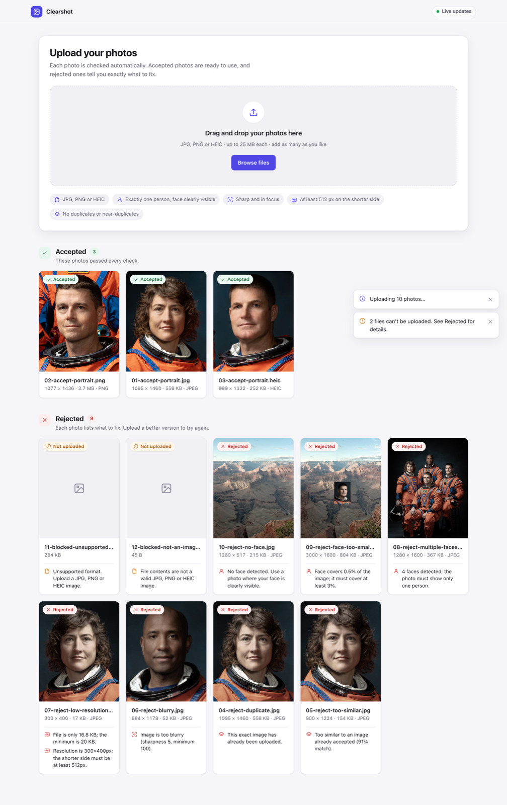
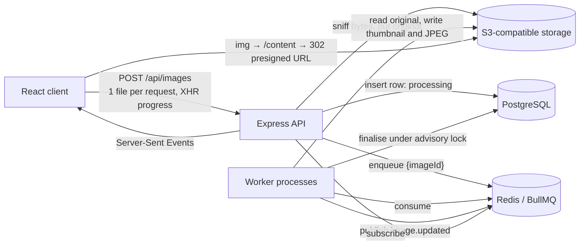

# Clearshot

**Photo intake that tells you exactly what to fix.**

Upload photos and get an instant, explained verdict for each one. Every image is validated asynchronously and lands in **Accepted** or **Rejected**, with the exact reasons (blurry, too small, duplicate, no face, several faces, face too small, wrong format).



**Stack:** React 19 + Vite (TypeScript) · Node 24 + Express 5 · BullMQ on Redis · PostgreSQL 17 via Knex · S3-compatible storage (RustFS locally) · sharp, libheif and ONNX Runtime for image analysis.

---

## Quick start

Prerequisites: Node 22.12+ (24 recommended, see `.nvmrc`) and Docker.

```bash
cp .env.example .env          # defaults work as-is
npm install
npm run infra:up              # Postgres, Redis and object storage in Docker
npm run db:migrate
npm run dev                   # API :4000, worker, web app :5173
```

Open http://localhost:5173.

To see every rule in action, generate the demo set and drop the whole folder onto the page:

```bash
npm run samples -w server     # writes 12 files to ./samples
```

| Sample | Expected result |
| --- | --- |
| `01-accept-portrait.jpg`, `02-…png`, `03-…heic` | Accepted (the HEIC is also converted to JPEG) |
| `04-reject-duplicate.jpg` | Rejected: exact duplicate of 01 |
| `05-reject-too-similar.jpg` | Rejected: re-encoded and cropped copy of 01 |
| `06-reject-blurry.jpg` | Rejected: blurry |
| `07-reject-low-resolution.jpg` | Rejected: resolution and file size too small |
| `08-reject-multiple-faces.jpg` | Rejected: 4 faces |
| `09-reject-face-too-small.jpg` | Rejected: face covers 0.5% of the image |
| `10-reject-no-face.jpg` | Rejected: no face |
| `11-…gif`, `12-blocked-not-an-image.jpg` | Blocked in the browser and never uploaded (the API would answer 415) |

The storage console is at http://localhost:9001 (credentials in `.env`).

## Validation rules

| Rule | How it is checked | Default |
| --- | --- | --- |
| Format: JPG, PNG or HEIC | Browser: extension, MIME type and magic bytes. Server: magic bytes only, with a synchronous **415**. The filename and `Content-Type` are never trusted. | n/a |
| Too small: bytes | File size | < 20 KB |
| Too small: resolution | Shorter side, after EXIF rotation | < 512 px |
| Blurry | Variance of the Laplacian on a grayscale copy normalised to 512 px. With exactly one face, it is measured **on the face**, so portrait-mode bokeh isn't penalised. | < 100 |
| Too similar | SHA-256 exact match (`DUPLICATE`), then a 64-bit difference hash compared by Hamming distance against accepted images (`TOO_SIMILAR`) | ≤ 8 of 64 bits |
| No face | UltraFace RFB-640 (ONNX), confidence ≥ 0.7, non-max suppression | enabled |
| Multiple faces | Same detector | > 1 face |
| Face too small | Largest face box ÷ image area | < 3% |

Every failing rule is reported, not just the first, so users can fix everything in one go. All thresholds are environment variables (see `.env.example`).

The thresholds were calibrated on the fixtures:

- Sharp faces score 870–1,900. A `blur(2)` copy scores 13.
- Two different people are 24–25 bits apart. Re-encoded or cropped copies are 0–6 bits apart.
- Decoding plus face detection takes about 20 ms for a JPEG and about 75 ms for a HEIC.

> Rejecting photos with **no** face goes slightly beyond the brief. Without it, a face too small for the detector to find would pass the "face too small" rule. It can be turned off with `VALIDATION_REJECT_NO_FACE=false`.

## Architecture



**Request lifecycle**

1. The browser validates each file and uploads up to three at a time, each in its own request, with per-file progress.
2. The API sniffs the magic bytes and streams the original to object storage under a server-generated key. It inserts a `processing` row, enqueues a job (`jobId = imageId`, so the job is idempotent) and returns **202 Accepted** with a `Location` header.
3. A worker decodes the image once. HEIC goes through libheif, because sharp's prebuilt binaries have no HEVC decoder. The worker then writes a metadata-free WebP thumbnail (plus a full-size JPEG for HEIC) and runs the analysers.
4. The verdict is written in one transaction together with its rejection reasons. The worker then publishes an event, the API relays it over SSE, and the card moves to Accepted or Rejected without a page refresh.

**Design decisions**

- **API and worker are separate processes.** Untrusted image decoding never runs in the HTTP server, and workers scale on their own (`WORKER_CONCURRENCY`, more replicas).
- **Failures are explicit.** Jobs retry with exponential backoff, three attempts by default. After the last attempt the image becomes `failed` with a user-safe message. Undecodable files are a *rejection* (`UNREADABLE_IMAGE`), not a retry.
- **Duplicate decisions are race-free and deterministic.**
  - The duplicate check and the status write share a transaction that holds a Postgres advisory lock, so two look-alikes processed in parallel can never both be accepted.
  - When look-alikes arrive together, **the earliest upload wins**. Each job stores its hash right after decoding. An image that would otherwise be accepted first waits briefly for any older look-alike that is still processing.
  - The wait is bounded, and uploads older than two minutes are ignored, so a stuck job can't block anyone.
- **Image bytes never pass through the API on reads.** `GET /images/:id/content` returns a 302 to a five-minute presigned URL, and the redirect is cached for slightly less time than the URL stays valid.
- **Storage is plain S3 API.** Locally that's [RustFS](https://github.com/rustfs/rustfs), an Apache-2.0 drop-in for MinIO, whose community images are no longer published. AWS S3, Cloudflare R2 or MinIO work by changing the `S3_*` variables. `S3_PUBLIC_ENDPOINT` covers split-horizon setups such as Docker.
- **Real-time with a safety net.** If an SSE event is missed, the client re-syncs pending items when it reconnects and also polls them every 5 s.

## Data model

```text
images                       one row per upload
  id uuid PK, original_filename, format enum(jpeg|png|heic), mime_type, size_bytes,
  width, height, sha256, phash bigint, status enum(processing|accepted|rejected|failed),
  blur_score, face_count, face_area_ratio, similar_to_id → images,
  original_key, converted_key, thumbnail_key, error_message,
  created_at, updated_at (trigger), processed_at

image_rejection_reasons      one row per failed rule, so reasons can be queried
  id, image_id → images ON DELETE CASCADE, code enum, message, details jsonb,
  UNIQUE (image_id, code)
```

| Index | Serves |
| --- | --- |
| `(status, created_at DESC, id DESC)` | Keyset pagination of each section |
| `(phash) INCLUDE (id) WHERE status = 'accepted'` | Index-only Hamming-distance scan (`bit_count(phash # $1)`) |
| `(sha256) WHERE status = 'accepted'` | Exact-duplicate lookup |
| `(similar_to_id) WHERE NOT NULL` | `ON DELETE SET NULL` without a sequential scan |

Lists load the reasons for a whole page in one `WHERE image_id IN (…)` query, so there is no N+1.

## REST API

All routes are under `/api`. Errors always look like `{ "error": { "code", "message", "details?" } }`.

| Method | Path | Result |
| --- | --- | --- |
| `POST` | `/images` | multipart `file` → `202` + image. `400` no file · `413` > 25 MB · `415` not JPEG/PNG/HEIC · `429` rate limited · `503` queue down |
| `GET` | `/images?status=accepted\|rejected,failed&limit=24&cursor=` | `{ data, nextCursor }` using keyset pagination |
| `GET` | `/images/summary` | Counts per status |
| `GET` | `/images/:id` | One image, with reasons and metrics |
| `GET` | `/images/:id/content?variant=thumbnail\|original\|converted` | `302` to a presigned URL |
| `DELETE` | `/images/:id` | `204`. Removes the row, its reasons and its stored objects, and notifies other clients |
| `GET` | `/events` | SSE stream of `image.updated` and `image.deleted` |
| `GET` | `/health` | Status of Postgres, Redis and storage (`200` or `503`) |

## Security

- **Formats:** content sniffing on both sides. SVG and other active formats can't get in.
- **Upload limits:** multer keeps one file in memory with a 25 MB cap, and caps the number of parts, fields and header pairs. Uploads are rate-limited per IP.
- **Decompression bombs:** a 50-megapixel limit applies before decoding, including HEIC, whose dimensions are read before its pixels are decoded.
- **Storage keys:** generated from UUIDs only. Filenames are sanitised (path parts, control characters, length, UTF-8 repair) and used purely for display and `Content-Disposition`.
- **Bucket access:** the bucket is private and every read goes through a short-lived signed URL. Served images are re-encoded, which strips EXIF/GPS metadata and neutralises polyglot files.
- **HTTP hardening:** helmet, CORS limited to the client origin, and zod validation of every parameter and environment variable. The error handler never leaks internals.
- **Model integrity:** the face model's SHA-256 is verified at startup.

## Frontend

- **State:** a single `useReducer` store behind context holds local uploads and server images, normalised by id. Selectors turn both into one card view model, so components stay presentational.
- **Upload queue:** three parallel uploads over XHR, because fetch can't report upload progress. Failures can be retried. Files refused by the server (413/415) move to Rejected instead of offering a pointless retry.
- **Live updates:** a hook wraps `EventSource`. A live indicator in the header shows connection state, and an `aria-live` region announces each result.
- **Previews:** JPEG and PNG appear instantly from object URLs, which are revoked when no longer used. HEIC, which most browsers can't render, shows the server thumbnail once processed.
- **Races:** handled in the reducer. For example, a worker can finish before the upload response arrives.
- **Design:** responsive grid, light and dark themes, reduced-motion support, and keyboard and screen-reader friendly controls, including an inline delete confirmation.

## Tests

```bash
npm test                       # everything (server integration tests need `npm run infra:up`)
npm run test:unit -w server    # server unit tests, no Docker needed
npm run test -w client
npm run typecheck && npm run lint
```

- **Server unit tests:** magic bytes and HEIF/AVIF brands, filename sanitising, every rule, the hash (including signed 64-bit storage), sharpness, decoding (HEIC, EXIF rotation, corruption, pixel limit), face detection on real photos, NMS and IoU geometry, and cursors.
- **Server integration tests** (real Postgres, Redis and storage via supertest):
  - Upload, then 202 and a queued job.
  - 415 and 413 responses.
  - Each rejection reason end to end.
  - HEIC conversion.
  - Presigned redirects.
  - Pagination and the summary.
  - Delete removing both the row and its objects.
  - Parallel look-alikes, where the earliest upload is accepted.
- **Client tests:** file validation, reducer transitions and races, selectors, and the card's delete and retry flows.

## Project layout

```text
server/src
  config/env.ts            zod-validated configuration
  modules/images/          router → service → repository, DTO, schemas, cursors
  processing/              raster decoding, analyzers/, rules.ts (pure), imageProcessor.ts
  queue/                   BullMQ queue, Redis pub/sub events
  storage/                 S3 client wrapper and key layout
  http/                    app factory, middleware, SSE hub
  server.ts, worker.ts     process entry points with graceful shutdown
server/tests               unit/, integration/, fixtures/ (public-domain photos)
client/src
  api/                     typed client and contract types
  features/uploads/        reducer, selectors, hooks (queue, events), provider, validation
  components/              Dropzone, ImageCard, GallerySection, StatusBadge, toasts
```

## Scaling notes and trade-offs

- **Bigger uploads:** move to presigned direct-to-S3 uploads (`POST` signed form with `content-length-range`). The API would then never touch upload bytes, and validation would start from an S3 event or a "complete" call.
- **Similarity at 10M+ images:** the exact `bit_count` scan stays fast into the millions of rows. Beyond that, use pgvector's `bit` type with an HNSW Hamming index, or multi-index hashing.
- **Several API instances:** share the rate limit through a Redis store. A transactional outbox (or pg-boss) would make "insert row and enqueue" atomic. Today, an enqueue failure marks the row `failed` and returns 503.
- **No authentication:** the brief doesn't ask for it, so the gallery and duplicate checks are global. Adding `owner_id` would scope both, and would let the advisory lock be per user.
- **Housekeeping:**
  - Apply an S3 lifecycle rule to rejected originals.
  - Add a sweeper for rows stuck in `processing` after a lost job.
- **Detection limits:**
  - dHash isn't rotation- or mirror-invariant.
  - The face detector favours roughly frontal faces.
  - HEIC wide-gamut colour is converted without full colour management.

## Credits

The test photos are public-domain NASA and National Park Service images from Wikimedia Commons. The face detector is [Ultra-Light-Fast-Generic-Face-Detector-1MB](https://github.com/Linzaer/Ultra-Light-Fast-Generic-Face-Detector-1MB) (MIT).
